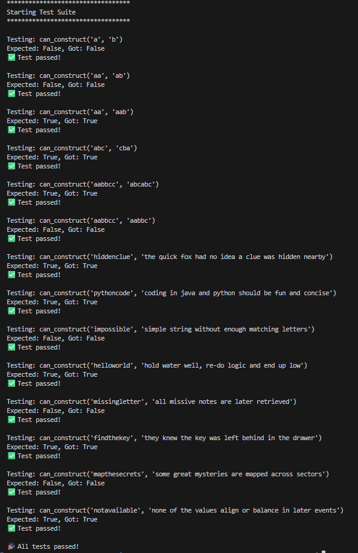

# Lab: Hash Tables – Ransom Note Construction
## Overview

This project demonstrates the use of **hash tables (Python dictionaries)** to solve a character frequency matching problem.

The goal is to implement a function that determines whether a ransom note can be constructed using the characters available in a magazine.

Each character in the magazine can only be used once. The algorithm must account for both the presence of a character and the number of times it appears.

This lab focuses on efficient dictionary operations, conditional logic, iteration, and algorithmic complexity.

## Learning Objectives

The primary objectives of this assignment are to:

- Understand how hash tables store data using key-value pairs.
- Use Python dictionaries to track character frequencies.
- Implement efficient character lookup and counting.
- Apply conditional logic to identify missing or exhausted characters.
- Understand short-circuit evaluation.
- Analyze time and space complexity using Big O notation.
- Validate functionality using an automated test suite.

## Technologies Used

- **Python 3**
- **Python Dictionaries (Hash Tables)**
- **Python Standard Library**
- **Git & GitHub**
- **Visual Studio Code**

## Project Structure

```text
hash-table-ransom-note-lab/
├── ransom_note.py
├── test_ransom_note.py
├── screenshots/
│   └── test_suite.png
└── README.md
```

### File Descriptions

| File | Description |
|------|-------------|
| `ransom_note.py` | Contains the ransom note construction algorithm. |
| `test_ransom_note.py` | Contains automated tests to validate the algorithm. |
| `screenshots/test_suite.png` | Screenshot demonstrating successful test execution. |
| `README.md` | Provides project documentation and implementation details. |

## Problem Description

Implement the following function:

```python
def can_construct(ransomNote: str, magazine: str) -> bool:
```

The function accepts two strings:

- `ransomNote`: The characters required to construct the ransom note.
- `magazine`: The available characters that can be used.

The function returns:

- `True` if all required characters are available.
- `False` if any required character is missing or has already been exhausted.

### Rules

1. Each character in `magazine` can only be used once.
2. Extra characters in `magazine` are permitted.
3. Character frequency must be tracked using a dictionary.
4. Character comparisons are case-sensitive in this implementation.
5. The function must return a Boolean value.

## Algorithm Implementation

The solution uses a dictionary named `letter_counts` to track the frequency of each character in the magazine.

The algorithm consists of two main phases.

### Phase 1: Build the Frequency Dictionary

First, an empty dictionary is initialized.

```python
letter_counts = {}
```

The algorithm iterates through each character in `magazine`.

```python
for char in magazine:
    if char in letter_counts:
        letter_counts[char] += 1
    else:
        letter_counts[char] = 1
```

If a character already exists in the dictionary, its count is incremented.

Otherwise, the character is added with an initial count of `1`.

**Example:**

```python
magazine = "banana"
```

The resulting dictionary is:

```python
{
    "b": 1,
    "a": 3,
    "n": 2
}
```

This allows the algorithm to track how many times each character can be used.

### Phase 2: Validate the Ransom Note

The algorithm then iterates through each character in `ransomNote`.

```python
for char in ransomNote:
    if char not in letter_counts or letter_counts[char] == 0:
        return False

    letter_counts[char] -= 1
```

For each character:

1. Check whether the character exists in the dictionary.
2. Check whether its available count has reached zero.
3. Return `False` immediately if either condition is met.
4. Otherwise, decrement the character's available count by one.

If every character is successfully processed, the function returns `True`.

```python
return True
```

### Short-Circuit Evaluation

The algorithm uses Python's `or` operator:

```python
if char not in letter_counts or letter_counts[char] == 0:
```

Python evaluates this expression from left to right.

If the character does not exist in the dictionary, the first condition evaluates to `True`, and Python skips the second condition.

This prevents a potential `KeyError` caused by attempting to access a nonexistent dictionary key.

## Example Scenarios

The following examples demonstrate the expected behavior of the algorithm.

| Ransom Note | Magazine | Expected Result | Explanation |
|-------------|----------|-----------------|-------------|
| `"abc"` | `"abcdef"` | `True` | All required characters are available. |
| `"aaa"` | `"aa"` | `False` | Insufficient occurrences of `"a"`. |
| `"xyz"` | `"abc"` | `False` | Required characters are missing. |
| `"ban"` | `"banana"` | `True` | All required characters are available. |
| `"band"` | `"banana"` | `False` | The character `"d"` is missing. |
| `""` | `"abc"` | `True` | An empty ransom note requires no characters. |
| `"abc"` | `""` | `False` | No characters are available. |
| `""` | `""` | `True` | No characters are required. |

## Big O Complexity Analysis

The algorithm uses a hash table to provide efficient character lookup and frequency tracking.

### Time Complexity: O(m + n)

Where:

- `m` represents the number of characters in `magazine`.
- `n` represents the number of characters in `ransomNote`.

The algorithm performs two separate loops.

**First loop:**

```python
for char in magazine:
```

This loop processes each magazine character once, requiring O(m) time.

**Second loop:**

```python
for char in ransomNote:
```

This loop processes each ransom note character at most once, requiring O(n) time.

Dictionary lookups, insertions, and updates have an average time complexity of O(1).

Therefore, the total average time complexity is:

**O(m + n)**

Because the loops execute sequentially rather than being nested, their complexities are added rather than multiplied.

### Space Complexity: O(k)

The algorithm creates a dictionary containing character frequencies.

Where:

- `k` represents the number of unique characters in `magazine`.

Each unique character requires one dictionary entry.

Therefore, the auxiliary space complexity is:

**O(k)**

Since the number of unique characters cannot exceed the magazine length, the worst-case auxiliary space complexity is also O(m).

For a fixed-size character alphabet, auxiliary space can be considered O(1) relative to the input length.

### Why Use a Hash Table?

Using a dictionary eliminates the need to repeatedly search through the magazine for every required character.

This provides efficient average-case lookup performance and makes the solution scalable for larger inputs.

## Installation and Setup

### 1. Clone the Repository

```bash
git clone <your-repository-url>
```

### 2. Navigate to the Project Directory

```bash
cd hash-table-ransom-note-lab
```

### 3. Verify Python Installation

```bash
python --version
```

The project uses Python 3 and does not require additional third-party packages for the algorithm.

## Running the Tests

The project includes an automated test suite to validate the implementation.

From the project root directory, run:

```bash
python test_ransom_note.py
```

The test suite checks whether the function correctly determines if a ransom note can be constructed from the available magazine characters.

### Test Suite Output Formatting

A formatted header was added to the test file to make terminal output easier to identify and read, and for obtaining a screenshot.

```python
# Display a formatted header to distinguish the test suite output
# from other terminal messages.
print("**********************************")
print("Starting Test Suite")
print("**********************************\n")
```

This is a presentation-only improvement and does not modify the underlying test assertions or algorithm.

### Test Results

**Status: All provided tests passing.**

The completed implementation was validated using the supplied automated test suite.

## Screenshots

### Successful Test Suite

The screenshot below demonstrates successful execution of the automated tests.



## Key Takeaways

This assignment reinforced several important programming concepts:

1. **Hash Tables:** Dictionaries provide efficient key-value storage and lookup.
2. **Frequency Counting:** Character occurrences can be tracked using dictionary values.
3. **Conditional Logic:** Missing or exhausted characters can be detected using Boolean expressions.
4. **Short-Circuit Evaluation:** Python avoids unnecessary evaluations when a Boolean expression's result is already determined.
5. **Early Returns:** Returning `False` immediately prevents unnecessary processing.
6. **Algorithm Efficiency:** Sequential loops and average O(1) dictionary operations produce an efficient O(m + n) solution.
7. **Code Documentation:** Docstrings and concise comments make algorithms easier to understand and maintain.

## Conclusion

The Hash Tables – Ransom Note Construction lab demonstrates how Python dictionaries can efficiently solve character frequency matching problems.

By counting available characters and decrementing their frequencies as they are used, the algorithm ensures that each character is consumed at most once.

The final solution achieves **O(m + n) average time complexity** with **O(k) auxiliary space complexity**, demonstrating the practical benefits of hash tables in algorithm design.

## Author

Created by Matthew Swanberg as part of Course 10 Module 6 (Lab: Hash Tables)
